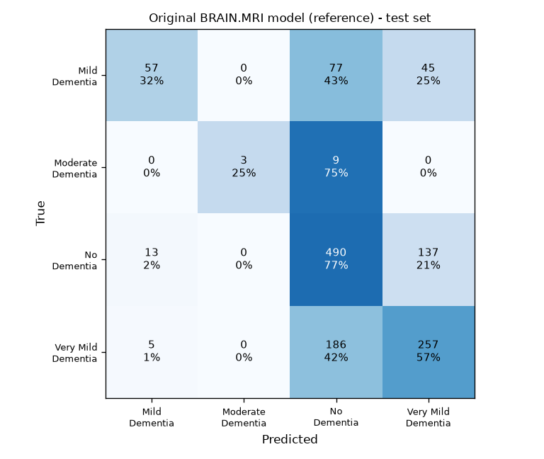
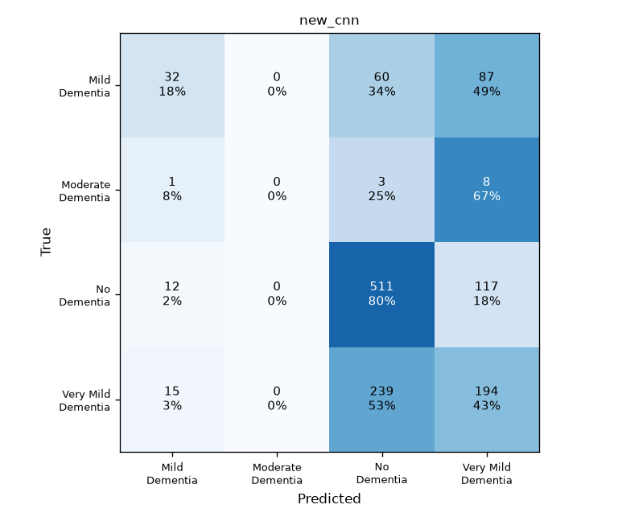
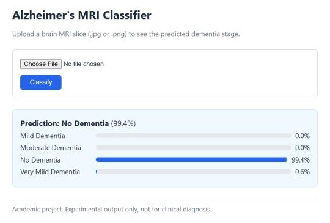

# Alzheimer's Disease Detection from Brain MRI

Classifies a 2D brain MRI slice into one of four dementia stages with a convolutional neural network (CNN), served through a small Flask web app.

This started as a **B.Tech final-year team project at RGUKT Basar (2023–24)**. In a 2026 portfolio update it was rebuilt as a reproducible pipeline with its own model, held-out evaluation, Grad-CAM, input validation and automated tests.

> **Experimental academic project.** Not a medical device, not clinically validated, and not for diagnosis.

## What's in this repository

| Part | Status |
|---|---|
| Original B.Tech documentation: UML diagrams, screenshots, functional tests | From the 2023–24 team project |
| `alzmri/`: preprocessing, CNN, training, evaluation, duplicate check, Grad-CAM | New in the 2026 update |
| `webapp/`: Flask app with upload validation | New in the 2026 update |
| `tests/`: 22 automated tests | New in the 2026 update |
| `results/`: measured test-set metrics and confusion matrices | New in the 2026 update |

The original B.Tech app and model were adapted from the public [BRAIN.MRI](https://github.com/Aytijha/BRAIN.MRI) project. None of its code or weights are included here (see [Provenance and licensing](#provenance-and-licensing)).

## Problem

Alzheimer's disease causes gradual loss of brain tissue, especially in memory-related regions such as the hippocampus. That shrinkage is visible on structural MRI, and MRI is non-invasive, which makes it a natural input for image classification. Earlier approaches we reviewed used tabular patient data with classical models such as SVM and Random Forest. This project classifies the MRI image directly.

**Classes:** No Dementia, Very Mild Dementia, Mild Dementia, Moderate Dementia.

## Pipeline

1. **Data:** grayscale MRI slices, 176 × 208 px, in fixed `train/` and `test/` folders. The split is left unchanged.
2. **Duplicate check:** `alzmri.check_leakage` hashes every image to find identical copies, and measures how close each test image is to its nearest training image.
3. **Validation split:** 15% of `train/`, stratified by class, with identical images kept on the same side. `test/` is not read during training.
4. **Model:** a small CNN with light augmentation (flip, shift, zoom), 2× downsampling, 4 convolution layers, global average pooling, dropout and a softmax over 4 classes.
5. **Class imbalance:** Moderate Dementia has only 52 training images. Training uses square-root class weights (fully balanced weights made training collapse onto that class).
6. **Training:** Adam optimiser, learning-rate reduction on plateau, early stopping, and the best checkpoint kept by validation loss.
7. **Evaluation:** on the untouched `test/` folder. Reports accuracy, balanced accuracy, macro and per-class precision, recall and F1, and a confusion matrix.
8. **Grad-CAM:** heatmaps of the image regions that most influenced a prediction.

## Results (experimental)

Both models were evaluated on the same 1,279 `test/` images with the same class order. These are single runs on one dataset split, not general performance claims.

| Model | Accuracy | Balanced acc. | Macro precision | Macro recall | Macro F1 |
|---|---|---|---|---|---|
| Original BRAIN.MRI model (reference, not redistributed) | 0.631 | 0.477 | 0.747 | 0.477 | 0.532 |
| New CNN, run 1 (25-epoch cap, stopped while still improving) | 0.552 | 0.318 | 0.382 | 0.318 | 0.298 |
| **New CNN, run 2 (70-epoch cap, early-stopped at 42; current model)** | **0.576** | **0.353** | **0.410** | **0.353** | **0.356** |

Predicting "No Dementia" for every image would score 0.500 accuracy (640 of 1,279), so accuracy alone is misleading here. Macro F1 and balanced accuracy weight every class equally.

**Per-class recall:**

| Class (test images) | Original model | New CNN run 1 | New CNN run 2 |
|---|---|---|---|
| No Dementia (640) | 0.766 | 0.944 | 0.798 |
| Very Mild Dementia (448) | 0.574 | 0.161 | 0.433 |
| Mild Dementia (179) | 0.318 | 0.168 | 0.179 |
| Moderate Dementia (12) | 0.250 | 0.000 | 0.000 |

| Original model | New CNN (run 2) |
|---|---|
|  |  |

**What the numbers show:**
- **The new CNN does not outperform the original model.** Training longer (run 2) raised macro F1 from 0.298 to 0.356, but it is still well below the reference 0.532. It remains biased toward No Dementia: 53% of Very Mild test images are predicted as No Dementia, and Mild Dementia is split between Very Mild (49%) and No Dementia (34%).
- **Neither model handles the earlier stages well.** Very Mild and Mild Dementia are mostly confused with No Dementia, which fits how subtle the early changes are.
- **Moderate Dementia has only 12 test images**, so its metrics are very noisy: one image changes recall by 8 percentage points.
- **Training length was the first thing to fix.** Run 1 hit its 25-epoch cap with validation loss still falling. Run 2 used the same code and seed with a 70-epoch cap; early stopping ended it at epoch 42 (best validation loss at epoch 36). Run 1's outputs are kept outside the repo for comparison. Run 2 was chosen on validation loss alone, but it was trained after run 1's test results had been seen, so the test set is no longer strictly untouched.
- **Validation accuracy was higher than test accuracy** (run 2: 0.674 vs 0.576; run 1: 0.632 vs 0.552). One possible explanation is that slices from the same subject end up in both training and validation. That can't be verified, because the dataset has no subject IDs.

Full outputs: [`results/`](results/) (metrics JSON, classification reports, confusion matrices, training log, duplicate-check report).

**Evaluation conditions for the original model:** loaded with `tf-keras` from its SavedModel. It uses its own preprocessing (RGB, nearest-neighbour resize to 176 × 176, raw 0–255 pixel values), matching its training pipeline. No test-time augmentation was used.

## Dataset and integrity checks

The data is the Kaggle "Alzheimer's Dataset (4 class of Images)": 6,400 slices, 5,121 for training and 1,279 for testing. Its original Kaggle page is no longer available, and its licence could not be verified, so **no images from it are included in this repository**.

| Class | Train | Test |
|---|---|---|
| No Dementia | 2,560 | 640 |
| Very Mild Dementia | 1,792 | 448 |
| Mild Dementia | 717 | 179 |
| Moderate Dementia | 52 | 12 |

The duplicate check ([`results/leakage_check.json`](results/leakage_check.json)) found **no identical images** within either split or across train and test. Subject-level overlap cannot be ruled out, because the dataset has no subject IDs.

## Run it locally

Tested with Python 3.13 on Windows, CPU only.

```bash
python -m venv .venv
```

```bash
.venv\Scripts\activate
```

On macOS/Linux, activate with `source .venv/bin/activate` instead.

```bash
pip install -r requirements.txt
```

Place a copy of the dataset at `data/Alzheimer_s Dataset/` with `train/` and `test/` subfolders, each containing `MildDemented/`, `ModerateDemented/`, `NonDemented/` and `VeryMildDemented/`. Then run these from the repository root:

```bash
python -m alzmri.check_leakage --data-dir "data/Alzheimer_s Dataset"
```

```bash
python -m alzmri.train --data-dir "data/Alzheimer_s Dataset"
```

```bash
python -m alzmri.evaluate --data-dir "data/Alzheimer_s Dataset" --model models/alzmri_cnn.keras --name new_cnn
```

```bash
python -m alzmri.gradcam --model models/alzmri_cnn.keras --images "data/Alzheimer_s Dataset/test/MildDemented/26 (19).jpg"
```

```bash
python -m webapp.app
```

Then open http://127.0.0.1:5000. Training writes the model to `models/alzmri_cnn.keras`. Model weights are not stored in the repository, so the app shows a clear "No trained model found" message until you train one.

**Training cost:** run 2 (42 epochs) took about 17 minutes (1,026 s of epoch time) on a CPU-only Windows machine, partly while other jobs were running. A GPU is not required.

Run the tests (they use synthetic images, so no dataset or model is needed):

```bash
python -m pytest
```

## Web app

The app validates the file type (.jpg, .jpeg, .png), size (5 MB limit) and whether the file can be decoded as an image. Problems are shown as clear error messages. Uploads are processed in memory and never written to disk. The model is loaded once at startup.



*UI check using a synthetic gray oval, not an MRI. The model still predicts a class with high confidence, because it has no check for whether the input is a brain MRI (see Limitations).*

## Original B.Tech project (2023–24)

Our team's documented work: the project report (not included in this repository), system design (UML use case, class, activity and sequence diagrams in [`docs/uml`](docs/uml)), a general CNN illustration ([`docs/cnn-model-diagram.png`](docs/cnn-model-diagram.png)), functional testing of the upload flow, and documentation of the app.

| Upload page | Result |
|---|---|
|  |  |

More screenshots of the original app are in [`docs/screenshots`](docs/screenshots).

**Functional tests (original project, both passed):**
1. **Image format:** a valid `.jpg` is accepted and a result is shown; other formats are rejected.
2. **Image size:** an image of valid size is processed; an invalid size prompts the user for a correct image.

**Team:** T. Sreya, A. Sai Ruthik and T. Falguni, RGUKT Basar.

Guide: Mr. A. Surender (Assistant Professor). Coordinator: Mrs. Latha Reddy (Assistant Professor).

## Limitations and ethical use

- **Weak results:** test macro F1 is 0.53 for the reference model and 0.36 for the new CNN. Neither is reliable at separating the early dementia stages.
- **One dataset only:** a single public dataset of 2D slices, with no 3D context, patient history, scanner variety or external validation.
- **Small Moderate class:** only 12 Moderate Dementia test images.
- **Possible subject overlap:** subject-level overlap between splits cannot be checked.
- **No input check:** the app classifies any image, including ones that are not brain MRIs.
- **Grad-CAM is a visual aid:** it shows where the model looked, not whether the prediction is clinically correct.
- **Not for patient care:** outputs must not be used for diagnosis or any clinical decision.

## Provenance and licensing

- The original B.Tech app and model were adapted from the public [BRAIN.MRI](https://github.com/Aytijha/BRAIN.MRI) project by Aytijha Chakraborty. That repository has no licence, so its code and weights are **not** redistributed here. Its model was evaluated locally only, to provide the reference results above.
- The code in `alzmri/`, `webapp/` and `tests/` was written new for the 2026 update. It does not copy the BRAIN.MRI source.
- The dataset is not included (licence unverified), and neither are trained weights derived from it.
- No licence file has been added yet, so all rights are reserved by default. A licence can be added later for the new code only.

## What I learned

- How CNNs are used for image classification, and how brain MRI images can be classified into four categories.
- The basic machine learning workflow: image preprocessing, data augmentation, class balancing, model training and prediction.
- How a Flask web application connects a user interface with a machine learning model to display predictions.
- Documenting a B.Tech team project, designing UML diagrams, testing application workflows, and presenting technical work on GitHub.

## References

1. M. J. Knight, B. McCann, R. A. Kauppinen, E. J. Coulthard, *Magnetic Resonance Imaging to Detect Early Molecular and Cellular Changes in Alzheimer's Disease*.
2. K. Trojachanec, I. Kitanovski, I. Dimitrovski, S. Loshkovska, *Longitudinal brain MRI retrieval for Alzheimer's disease using different temporal information*.
3. S. Sarraf, G. Toghi, *Classification of Alzheimer's disease using fMRI data and deep learning convolutional neural networks*.
4. N. Bhagwat, *Prognostic applications for Alzheimer's disease using magnetic resonance imaging and machine learning*.
5. J. Shijie, W. Ping, J. Peiyi, H. Siping, *Research on data augmentation for image classification based on convolution neural networks*.
6. S. Al-Shoukry, T. H. Rassem, N. M. Makbol, *Alzheimer's Diseases Detection by Using Deep Learning Algorithms: A Mini-Review*, IEEE Access, 2020.
7. R. R. Selvaraju et al., *Grad-CAM: Visual Explanations from Deep Networks via Gradient-based Localization*, ICCV 2017.
