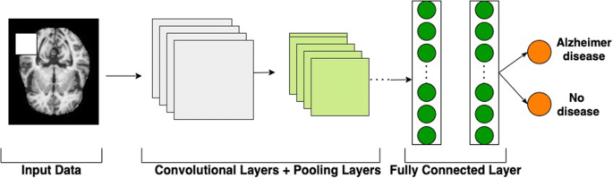
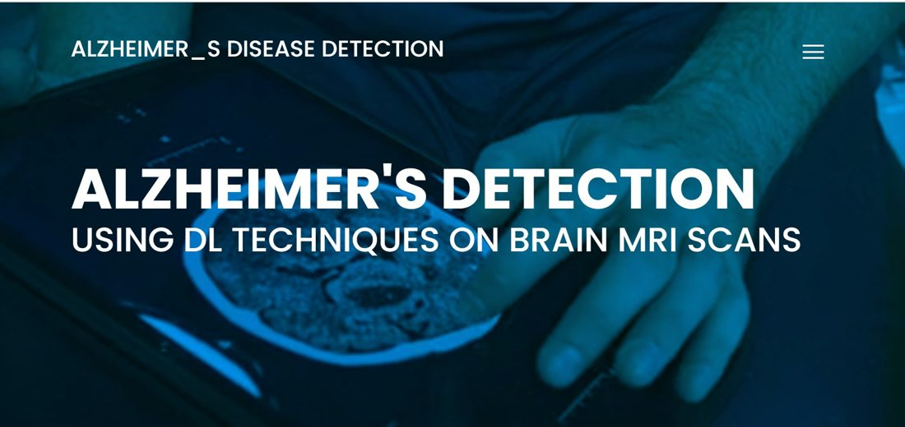
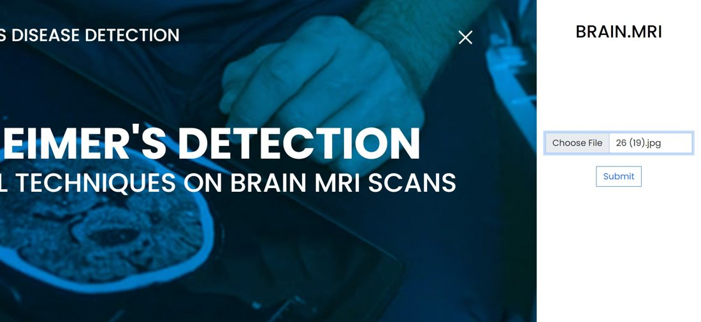
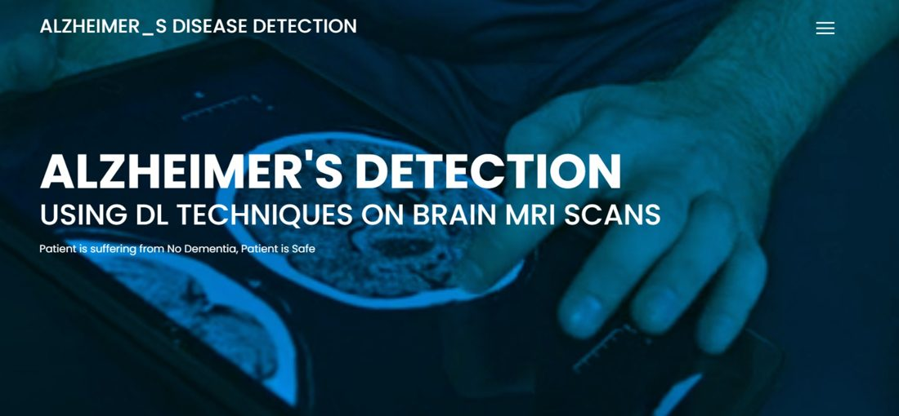
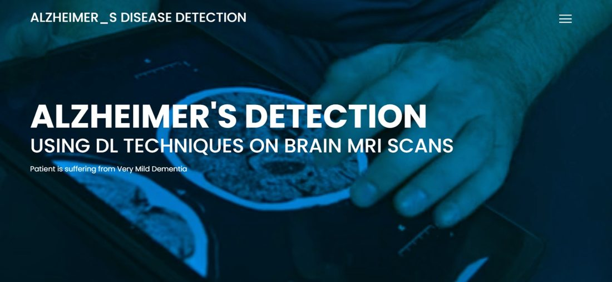
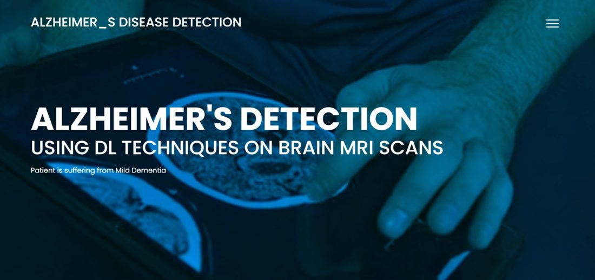
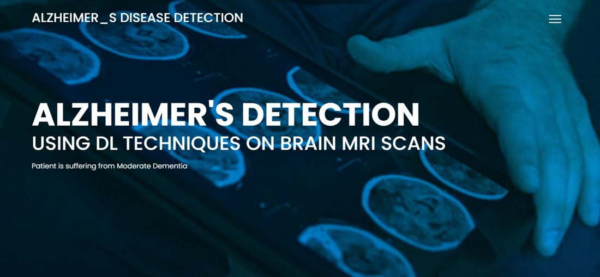

# Alzheimer's Disease Detection from Brain MRI

A B.Tech final-year team project (RGUKT Basar, 2023–2024). A convolutional neural network (CNN) classifies a brain MRI image into one of four dementia stages, and a Flask web app lets a user upload an image and see the prediction.

> **Academic prototype only.** Not a medical device and not validated for clinical use.

## Objective
Alzheimer's disease is the most common form of dementia and has no cure, so detecting it early matters. Earlier approaches we reviewed used tabular patient data (such as age and number of visits) with classical models like SVM and Random Forest, where the data is noisy and feature extraction is slow. This project classifies the **MRI image directly** with a CNN instead.

## Why brain MRI
Alzheimer's disease causes a gradual loss of brain tissue, especially in memory-related regions such as the hippocampus, and this shrinkage is visible on structural MRI scans. MRI is also non-invasive, so it suits an image-based classification approach.

## Classes predicted
| Class |
|---|
| No Dementia |
| Very Mild Dementia |
| Mild Dementia |
| Moderate Dementia |

## Model
- Input: brain MRI image resized to **176 × 176**
- Stacked convolution and max-pooling blocks, followed by fully connected (dense) layers
- Output: one of the **4 classes** above
- Training used image augmentation and oversampling to balance the classes, since the Moderate Dementia class has far fewer images than the others

*General illustration of how a CNN classifies an MRI image (convolution and pooling, then fully connected layers). The figure shows two outputs for simplicity; our model predicts four classes.*

## How the web application works
1. The user opens the web page and uploads a brain MRI image (`.jpg`).
2. The Flask app saves the file and resizes the image to 176 × 176.
3. The trained Keras model predicts a score for each of the four classes.
4. The class with the highest score is shown on the page as the result.

## Screenshots
| Upload page | File selected |
|---|---|
|  |  |

| No dementia | Very mild dementia |
|---|---|
|  |  |

| Mild dementia | Moderate dementia |
|---|---|
|  |  |

## Design (UML)
Use case, class, activity and sequence diagrams are in [`docs/uml`](docs/uml).

## Testing
Two functional tests on the upload flow, both passed:

| # | Test | Expected result |
|---|---|---|
| 1 | Image format | A valid `.jpg` is accepted and a result is shown; other formats are rejected |
| 2 | Image size | A valid-size image is processed; an invalid size prompts the user for a correct image |

## Technologies used
Python, TensorFlow / Keras (CNN), NumPy, Flask, HTML, CSS, JavaScript.

## What I learned
- How CNNs are used for image classification, and how brain MRI images can be classified into four categories.
- The basic machine learning workflow: image preprocessing, data augmentation, class balancing, model training and prediction.
- How a Flask web application connects a user interface with a machine learning model to display predictions.
- Documenting a B.Tech team project, designing UML diagrams, testing application workflows, and presenting technical work on GitHub.

## Limitations
- Not tested on clinical data, other MRI scanners or other populations.
- Classifies single 2D images, with no 3D context and no patient history.
- This repository holds the project documentation, diagrams and screenshots. The source code, trained model and dataset are not included.

## Team
B.Tech final-year project by T. Sreya, A. Sai Ruthik and T. Falguni, RGUKT Basar.

Guide: Mr. A. Surender (Assistant Professor). Coordinator: Mrs. Latha Reddy (Assistant Professor).

**Acknowledgement:** The CNN model and Flask app were adapted from the publicly available [BRAIN.MRI](https://github.com/Aytijha/BRAIN.MRI) project.

## References
1. M. J. Knight, B. McCann, R. A. Kauppinen, E. J. Coulthard, *Magnetic Resonance Imaging to Detect Early Molecular and Cellular Changes in Alzheimer's Disease*.
2. K. Trojachanec, I. Kitanovski, I. Dimitrovski, S. Loshkovska, *Longitudinal brain MRI retrieval for Alzheimer's disease using different temporal information*.
3. S. Sarraf, G. Toghi, *Classification of Alzheimer's disease using fMRI data and deep learning convolutional neural networks*.
4. N. Bhagwat, *Prognostic applications for Alzheimer's disease using magnetic resonance imaging and machine learning*.
5. J. Shijie, W. Ping, J. Peiyi, H. Siping, *Research on data augmentation for image classification based on convolution neural networks*.
6. S. Al-Shoukry, T. H. Rassem, N. M. Makbol, *Alzheimer's Diseases Detection by Using Deep Learning Algorithms: A Mini-Review*, IEEE Access, 2020.
